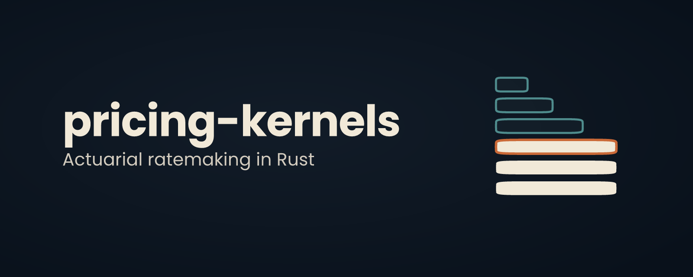

<p align="center">
  
</p>

<p align="center">
  <strong>Pure Rust numeric kernels for P&amp;C actuarial pricing and underwriting-risk capital modeling.</strong>
</p>

<p align="center">
  <a href="https://github.com/SinisterRob/pricing-kernels/actions/workflows/ci.yml"></a>
  <a href="Cargo.toml"></a>
  <a href="#license"></a>
  <a href="src/lib.rs"></a>
  <a href="Cargo.toml"></a>
  <a href="#building-and-testing"></a>
</p>

<p align="center">
  <a href="#quick-start">Quick Start</a> &nbsp;·&nbsp;
  <a href="#building-and-testing">Build &amp; Test</a> &nbsp;·&nbsp;
  <a href="docs/SOURCES.md">Literature</a> &nbsp;·&nbsp;
  <a href="https://github.com/SinisterRob/reserving-kernels">reserving-kernels</a>
</p>

---

`pricing-kernels` covers prospective commercial-lines ratemaking (classification, credibility, experience rating, ILFs, retrospective plans, large deductibles), treaty reinsurance pricing (MBBEFD exposure curves, burning cost, reinstatements, sliding-scale & profit commissions), and the **underwriting risk** module of capital modeling. Every method is implemented from peer-reviewed actuarial literature ([`docs/SOURCES.md`](docs/SOURCES.md)) and verified against published benchmark problems ([`tests/source_benchmarks.rs`](tests/source_benchmarks.rs)). Standalone sister crate to [`reserving-kernels`](https://github.com/SinisterRob/reserving-kernels) (retrospective loss development and reserve risk).

## Implemented Modules

| Area | Modules | Capabilities |
| --- | --- | --- |
| **Classification & Scoring** | `classification::{minimum_bias, irls_glm, diagnostics, scoring}` | Bailey (1963) & Bailey–Simon (1960) minimum bias, Poisson / Quasi-Poisson / Gamma / Tweedie / NegBin / Logistic / InvGauss IRLS GLMs + Ridge penalty + Tweedie power selection, Gini/Lorenz/double-lift/AIC/BIC/VIF diagnostics, zero-alloc `MultiplicativeRater` |
| **Credibility** | `credibility::{classical, buhlmann_straub, hachemeister}` | Longley-Cook limited-fluctuation credibility, non-parametric Bühlmann–Straub credibility, Hachemeister (1975) regression trend credibility |
| **Experience, Retro & Deductibles** | `experience::{ncci_erp, iso_erp, table_m, table_l, retrospective, deductible}` | NCCI WC ERP & off-balance, ISO Commercial ERP & bounded IRPM schedule rating, Lee (1988) Table M, Skurnick (1974) Table L, balanced retro solvers, large deductibles (ALAE inside/pro-rata/outside + aggregate caps) |
| **Severity, ILFs & Reinsurance** | `layers::{ilf, mbbefd, reinsurance}` | 6 parametric severity families (LEV/ILF/LER/excess), `CommercialLayer`, Bernegger (1997) MBBEFD / Swiss Re `Y1`–`Lloyds` exposure curves, Clark (2014) burning cost, Sundt (1991) reinstatements, sliding-scale / corridor / profit commissions |
| **Trending & On-Leveling** | `trending::{parallelogram, trend}` | Exact multi-change Calendar-Year earned parallelogram (annual & arbitrary policy terms) & Policy-Year written on-leveling, single-step & two-step exponential trending |
| **Underwriting-Risk Capital** | `underwriting_risk::{aggregate, catastrophe, risk_load, capital}` | Panjer `(a, b, 0)` & tilted radix-2 FFT aggregate risk, Cat ELT OEP/AEP/PML, Wang / PH / Kreps / RMK risk loads, Euler & Myers–Read capital allocation |
| **Fixtures & WASM** | `datasets`, `wasm_exports` (`--features wasm`) | Zero-I/O CAS Exam 5/8 benchmark fixtures, single-threaded `wasm32` C-ABI exports |

## Why `pricing-kernels`?

- **Zero heavy dependencies:** Pure Rust with no BLAS, LAPACK, or large external frameworks. Linear algebra, IRLS, and root-finding routines are built in and compile cleanly to `wasm32` (`--features wasm`).
- **Deterministic by design:** Numerical algorithms converge deterministically across native and browser targets.
- **Microsecond execution:** High-performance classification and commercial rating routines designed for real-time quotation engines, large-account underwriting workflows, and batch raters.
- **Actuarial verification:** Standard models verified against CAS Exam 5 and Exam 8 literature — Bailey & Simon (1960), Brown (1988), Bühlmann & Straub (1970), NCCI Experience Rating Plan, and Lee (1988) Table M.

## Quick Start

Add `pricing-kernels` to your `Cargo.toml`:

```toml
[dependencies]
pricing-kernels = "0.4"
```

### 1. Classification Minimum Bias (Bailey & Simon 1960)

```rust
use pricing_kernels::prelude::*;

fn main() -> Result<(), PricingError> {
    // 2x2 multi-dimensional classification table (exposures and average losses)
    let exposures = vec![1000.0, 800.0, 500.0, 400.0];
    let losses = vec![100.0, 120.0, 150.0, 180.0];

    let result = bailey_simon_multiplicative(2, 2, &exposures, &losses, 100, 1e-6)?;
    println!("Base Rate: {:.2}", result.base_rate);
    println!("Row Relativities: {:?}", result.relativities_dim1);
    println!("Column Relativities: {:?}", result.relativities_dim2);
    Ok(())
}
```

### 2. Workers' Compensation Experience Rating (NCCI ERP)

```rust
use pricing_kernels::prelude::*;

fn main() -> Result<(), PricingError> {
    let spec = NcciErpSpecification {
        split_point: 18_500.0,
        expected_losses: 120_000.0,
        d_ratio: 0.38,
        weight_w: 0.18,
        ballast_b: 25_000.0,
        apply_era: true,
    };

    let claims = vec![
        ExperienceClaim { incurred: 45_000.0, is_medical_only: false },
        ExperienceClaim { incurred: 8_200.0, is_medical_only: false },
        ExperienceClaim { incurred: 12_000.0, is_medical_only: true },
    ];

    let erp = calculate_ncci_experience_mod(&spec, &claims)?;
    println!("Experience Modification Factor: {:.3}", erp.mod_factor);
    Ok(())
}
```

### 3. Severity Layering & Increased Limits Factors (ILFs)

```rust
use pricing_kernels::prelude::*;

fn main() -> Result<(), PricingError> {
    let lomax = SeverityDistribution::Lomax { alpha: 2.2, theta: 150_000.0 };

    // Calculate $1M ILF relative to $500k basic limit
    let ilf_1m = lomax.increased_limits_factor(1_000_000.0, 500_000.0)?;
    println!("$1M ILF: {:.4}", ilf_1m);

    // Price a commercial excess layer: $4M excess of $1M
    let layer = CommercialLayer::new(1_000_000.0, 4_000_000.0, 1.0)?;
    let layer_cost = layer.layer_expected_loss(&lomax)?;
    println!("Layer Expected Loss: ${:.2}", layer_cost);
    Ok(())
}
```

### 4. Commercial Retrospective Rating Plan Solver

```rust
use pricing_kernels::prelude::*;

fn main() -> Result<(), PricingError> {
    let entry_ratios = vec![0.2, 0.6, 1.0, 1.4, 1.8];
    let probs = vec![0.1, 0.2, 0.4, 0.2, 0.1];
    let table_m = TableMEngine::from_discrete_pdf(&entry_ratios, &probs)?;

    let spec = RetroPlanSpec {
        standard_premium: 750_000.0,
        expected_loss_ratio: 0.65,
        lcf: 1.12,
        tax_multiplier: 1.035,
        max_retro_ratio: 1.35,
        min_retro_ratio: 0.55,
        expense_ratio: 0.18,
    };

    let plan = solve_balanced_retro_plan(&spec, &table_m, 100, 1e-5)?;
    println!("Basic Premium Factor: {:.4}", plan.basic_premium_factor);
    println!("Basic Premium Dollars: ${:.2}", plan.basic_premium_dollars);
    Ok(())
}
```

## Building and Testing

```bash
# Run unit, integration, doctest, and benchmark-parity tests
cargo test --all-targets --all-features
cargo test --doc --all-features

# Build for WebAssembly
cargo build --release --target wasm32-unknown-unknown --features wasm
```

## License

Licensed under either of [MIT](LICENSE-MIT) or [Apache-2.0](LICENSE-APACHE) at your option.
